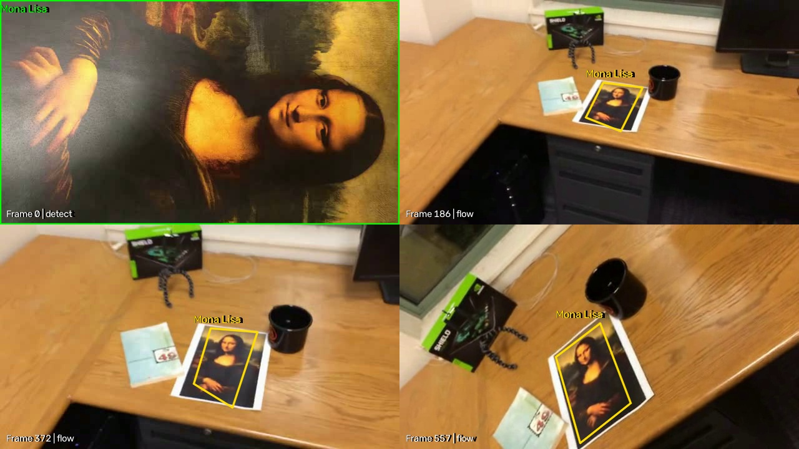
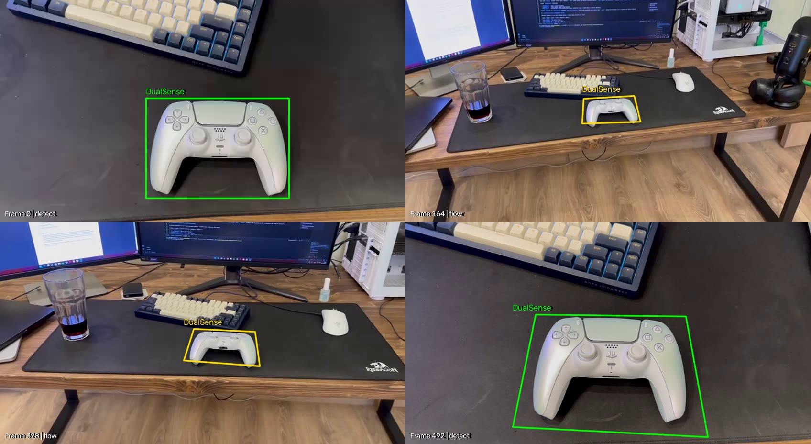

# Лабораторная работа №2

Цель: отслеживать один и тот же объект на видео и рисовать вокруг него рамку. Программа проверена на тестовых видео с картиной и на своём видео с геймпадом DualSense.

## 1. Теоретическая база

Для поиска объекта используются ключевые точки — заметные детали изображения, например углы или контрастные пятна. Такие детали легче найти повторно, чем одинаковые участки однотонной поверхности.

Точки находятся с помощью SIFT. Этот алгоритм позволяет сопоставлять детали объекта, даже если он стал меньше, больше или повернулся. Для каждой точки вычисляется дескриптор — набор чисел, который описывает изображение вокруг неё. По этим описаниям программа ищет похожие точки на первом и текущем кадрах. Неоднозначные и ошибочные совпадения отбрасываются.

По оставшимся совпадениям вычисляется гомография — преобразование, которое показывает, как изменились положение, размер и наклон плоского объекта. Через него переносятся углы исходной рамки. Поэтому рамка может поворачиваться и менять форму вместе с объектом.

Когда объект маленький или размытый, совпадений с первым кадром может не хватить. В этом случае используется оптический поток — отслеживание перемещения точек между соседними кадрами. Это помогает продолжать слежение, но со временем небольшие ошибки могут накапливаться и смещать рамку. Новое успешное сопоставление с первым кадром помогает исправить такое смещение.

## 2. Описание разработанной системы

Программа написана на Python. Библиотека OpenCV используется для чтения видео, поиска точек и рисования рамки. NumPy используется для хранения изображений и координат в виде числовых массивов.

В `tracker.py` находится алгоритм слежения, в `main.py` — чтение видео, вывод изображения и сохранение результата.

Алгоритм работы:

1. Запомнить первый кадр или выбранную область объекта как образец для поиска.
2. На очередном кадре найти точки, похожие на точки образца, и определить положение рамки.
3. Если совпадений недостаточно, отследить движение точек с предыдущего кадра.
4. Отбросить ненадёжные точки и явно неверную рамку, например слишком вытянутую или большую.
5. Если определить новое положение не удалось, оставить прежнюю рамку не более чем на 5 кадров. Затем убрать её и продолжать поиск объекта.

Цвет рамки показывает, как сейчас работает программа:

| Подпись на видео | Значение |
| --- | --- |
| `detect`, зелёный | Объект найден по сравнению с первым кадром. |
| `flow`, жёлтый | Объект отслеживается по движению точек между кадрами. |
| `hold`, оранжевый | Временно показана последняя известная рамка. |
| `lost`, без рамки | Объект потерян, поиск продолжается. |

По умолчанию образцом считается весь первый кадр. Если на нём есть другие предметы, нужно указать область объекта через `--roi`: левый верхний угол, ширину и высоту в пикселях. Это позволяет искать точки на нужном объекте, а не на фоне.

### Запуск

Из корня репозитория:

```shell
python lab2/main.py test-videos/mona-lisa.avi --label "Mona Lisa" --show
```

Для остальных тестовых видео:

```shell
python lab2/main.py test-videos/mona-lisa-blur.avi --label "Mona Lisa"
python lab2/main.py test-videos/mona-lisa-blur-extra-credit.avi --label "Mona Lisa"
```

`--label` задаёт подпись над объектом латиницей, `--show` открывает окно просмотра. Esc завершает обработку. Без `--show` результат сохраняется без открытия окна.

В папке `lab2/results` появляются видео с рамкой (`*_tracked.avi`), примеры кадров (`*_preview.jpg`) и статистика (`*_stats.json`). Другую папку можно указать через `--output`. Обработанные AVI исключены из Git и создаются при запуске программы.

## 3. Результаты работы и тестирования системы

Программа проверена на трёх тестовых видео размером 640×360.

| Видео | Кадров с рамкой | Скорость обработки, кадров/с |
| --- | ---: | ---: |
| `mona-lisa.avi` | 558 из 558 | 48,09 |
| `mona-lisa-blur.avi` | 558 из 558 | 48,42 |
| `mona-lisa-blur-extra-credit.avi` | 558 из 558 | 48,15 |

Рамка сохраняется при отдалении и повороте камеры. В размытых вариантах прежняя рамка удерживалась на 1 и 2 кадрах соответственно. На остальных кадрах её положение обновлялось по найденным точкам. Скорость измерена в одном запуске и зависит от компьютера.

Рамка есть на всех кадрах, но это не означает идеального совпадения с границами объекта: при длительном слежении она может смещаться и искажаться.




### Проверка на своём видео: DualSense

На своём видео камера сначала показывает геймпад крупно, затем отдаляется, меняет ракурс и возвращается к крупному плану. Видео содержит 493 кадра размером 848×464 с частотой 30 кадров/с.

На первом кадре рядом с геймпадом видна клавиатура. Поэтому область геймпада указана отдельно:

```shell
python lab2/main.py test-videos/my_video_dualsense.avi --label DualSense --roi 305 205 300 210 --show
```

Здесь `305 205` — координаты левого верхнего угла области, `300 210` — её ширина и высота. Эти значения подходят для первого кадра данного видео.

| Показатель | Результат |
| --- | ---: |
| Обработано кадров | 493 |
| Найден по сравнению с первым кадром | 98 |
| Отслеживается по движению точек | 395 |
| Потеря объекта | 0 |

При просмотре примеров по всей длине видео рамка остаётся вокруг геймпада. После возвращения камеры к крупному плану объект снова находится по сравнению с первым кадром.

Геймпад объёмный, а алгоритм рассчитан на плоский объект. Поэтому при изменении ракурса рамка может захватывать часть фона и неточно повторять границы геймпада.



## 4. Выводы по работе

Реализовано слежение за объектом по ключевым точкам. Сравнение с первым кадром позволяет находить объект, а отслеживание движения точек помогает не терять его при уменьшении и размытии. На тестовых видео и своём видео рамка сохраняется на всех кадрах. Основное ограничение — возможное смещение рамки при долгом слежении и изменении формы объекта в кадре.

## 5. Использованные источники

1. [OpenCV: поиск ключевых точек](https://docs.opencv.org/4.x/da/df5/tutorial_py_sift_intro.html).
2. [OpenCV: сопоставление точек и определение границ объекта](https://docs.opencv.org/4.x/d1/de0/tutorial_py_feature_homography.html).
3. [OpenCV: отслеживание движения точек](https://docs.opencv.org/4.x/d4/dee/tutorial_optical_flow.html).
