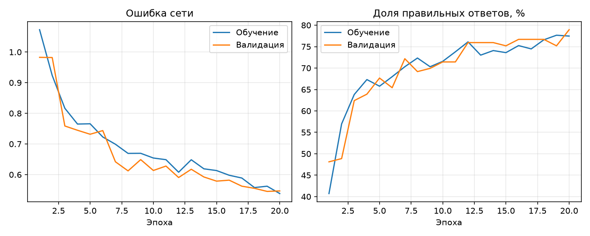
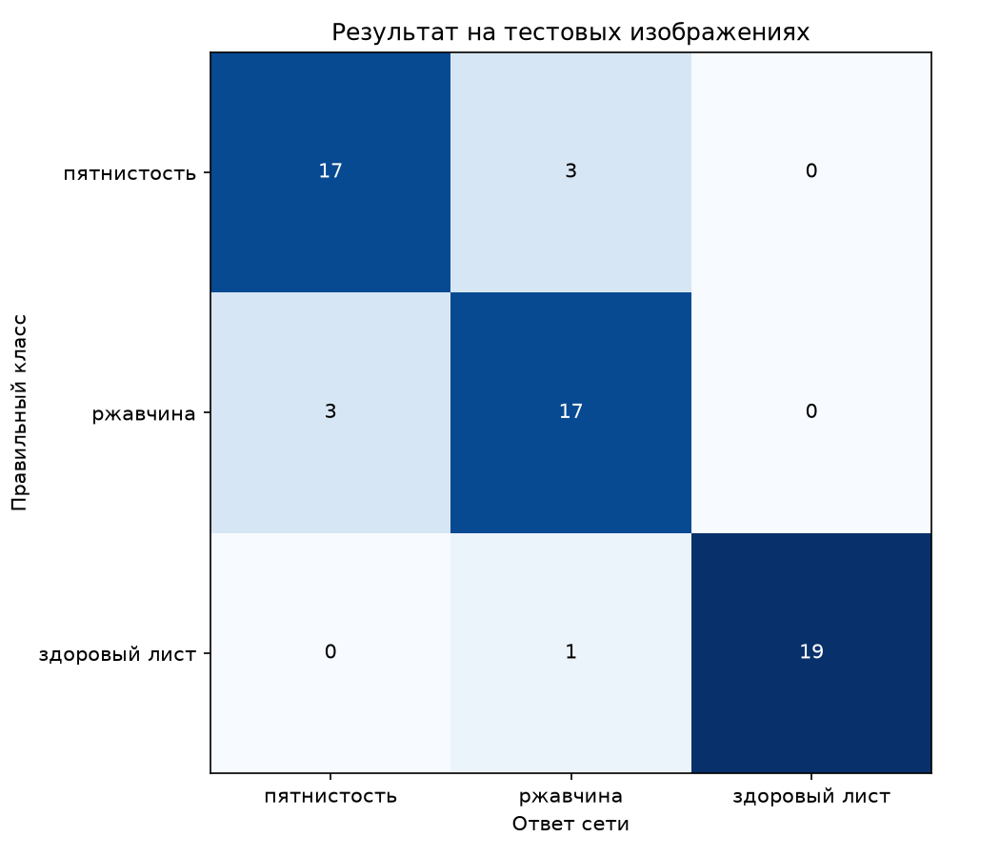
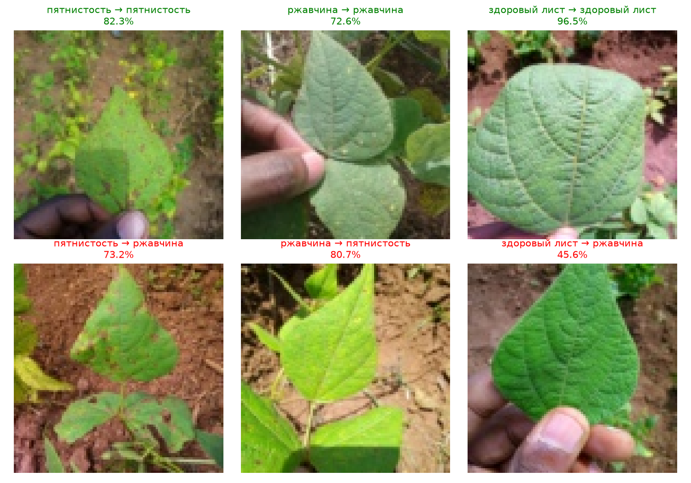
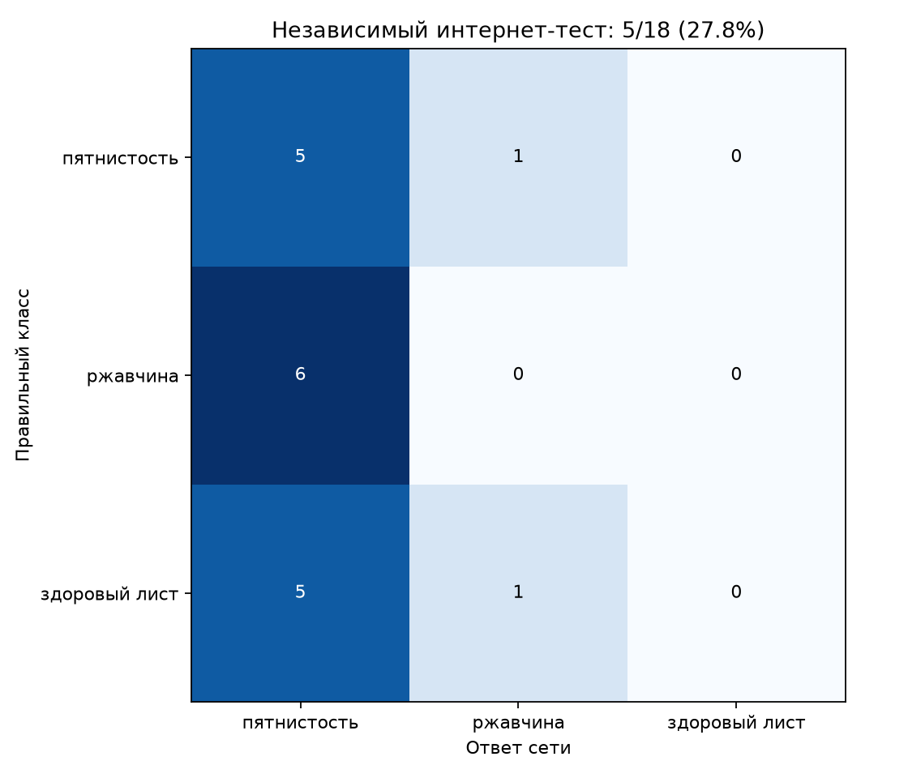
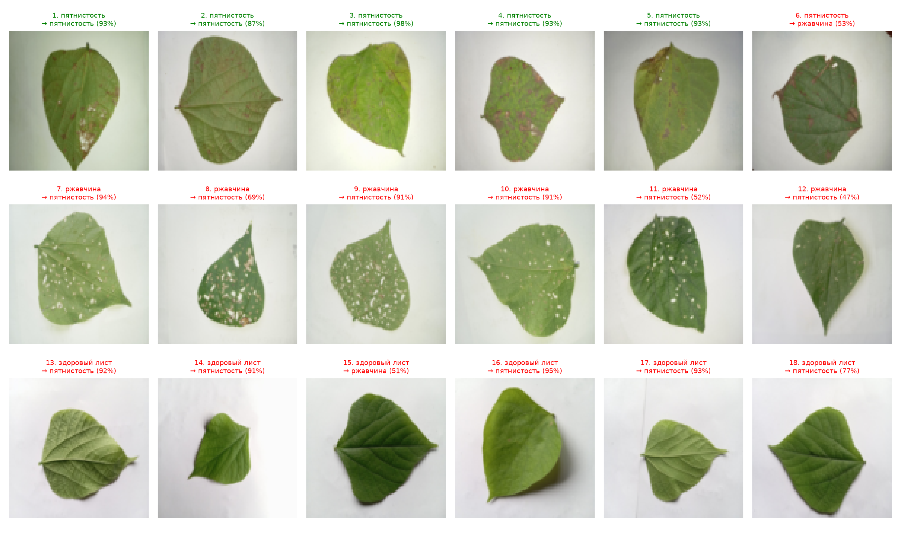

# Лабораторная работа №3

Цель: обучить простую свёрточную нейронную сеть определять состояние листа фасоли по фотографии. Используется датасет [Beans с Hugging Face](https://huggingface.co/datasets/AI-Lab-Makerere/beans).

## 1. Теоретическая база

Классификация — это выбор класса для изображения. В работе три класса: здоровый лист, пятнистость и ржавчина. На вход подаётся фотография листа, на выходе получается один из этих ответов.

Свёрточная нейронная сеть учится находить полезные детали изображения. Небольшие фильтры проходят по картинке и выделяют границы, цветовые переходы и другие признаки. Затем сеть использует эти признаки, чтобы выбрать класс. Параметры фильтров подбираются во время обучения на размеченных примерах.

После ответа вычисляется ошибка сети, или loss. В работе используется `CrossEntropyLoss`: она увеличивает ошибку при неправильном ответе, особенно если сеть в нём уверена. Во время обучения параметры сети изменяются так, чтобы уменьшать эту ошибку.

Данные разделены на обучение, валидацию и тест. На обучающих изображениях сеть изменяет свои параметры. На валидации проверяется после каждого полного прохода обучения — эпохи. Тест используется для итоговой оценки. Основная метрика — accuracy, то есть доля правильных ответов.

Если результат на обучении улучшается, а на валидации становится хуже, это признак переобучения: сеть запоминает обучающие примеры и хуже справляется с другими изображениями.

## 2. Описание разработанной системы

Программа написана на Python. PyTorch используется для создания и обучения сети. Библиотека Hugging Face Datasets скачивает датасет, Torchvision загружает и преобразует картинки, Matplotlib строит графики.

### Данные

Датасет `AI-Lab-Makerere/beans` содержит цветные фотографии листьев фасоли. Использованы готовые метки классов из датасета:

| Метка в данных | Значение |
| --- | --- |
| `angular_leaf_spot` | Пятнистость |
| `bean_rust` | Ржавчина |
| `healthy` | Здоровый лист |

Обучение и валидация взяты из соответствующих частей исходного набора. Для теста отобраны первые 20 изображений каждого класса из его отдельной тестовой части. Собственная съёмка и самостоятельная разметка заболеваний не выполнялись: сохранены исходные метки датасета.

| Выборка | Пятнистость | Ржавчина | Здоровые | Всего |
| --- | ---: | ---: | ---: | ---: |
| Обучение | 345 | 348 | 341 | 1034 |
| Валидация | 44 | 45 | 44 | 133 |
| Тест | 20 | 20 | 20 | 60 |

Изображения сохранены в `data/train`, `data/val` и `data/test`, внутри — папки классов. Файл `data/labels.csv` содержит метки и номера изображений в исходном наборе. В `data/source.json` записаны источник, версия датасета и лицензия MIT. Одинаковые файлы изображений между выборками не обнаружены.

Картинки уменьшаются до 96×96 пикселей. Цвет сохраняется, значения яркости переводятся из диапазона 0–255 в 0–1. При обучении изображения случайно отражаются по горизонтали и немного поворачиваются. Это добавляет разнообразия. При проверке случайные изменения отключены.

### Устройство сети

| Слой | Что делает | Размер результата |
| --- | --- | --- |
| Первая свёртка: 8 фильтров 3×3 и ReLU | Выделяет детали; ReLU заменяет отрицательные значения нулями | 8×96×96 |
| Уменьшение по областям 2×2 | Оставляет максимум каждой области | 8×48×48 |
| Вторая свёртка: 16 фильтров 3×3, ReLU и уменьшение | Обрабатывает признаки и сокращает размер | 16×24×24 |
| Третья свёртка: 32 фильтра 3×3, ReLU и уменьшение | Продолжает обработку признаков | 32×12×12 |
| Преобразование в список | Собирает признаки вместе | 4608 чисел |
| Полносвязный слой и ReLU | Объединяет признаки | 32 числа |
| Выходной слой | Выдаёт оценку каждого класса | 3 числа |

В сети 153 619 обучаемых параметров. Она обучается с нуля в течение 20 эпох, по 32 изображения за шаг. Для изменения параметров используется Adam со скоростью обучения 0,001. Эта скорость задаёт величину изменений параметров на каждом шаге.

После каждой эпохи вычисляется ошибка на валидации. Сохраняется модель с наименьшей ошибкой, тест для её выбора не используется.

### Файлы и запуск

- `prepare_data.py` — скачивает Beans с Hugging Face и сохраняет изображения по классам;
- `model.py` — содержит сеть и подготовку изображений;
- `train.py` — обучает сеть, сохраняет модель, графики и результаты;
- `predict.py` — определяет класс одной фотографии.

```shell
python -m pip install -r lab3/requirements.txt --extra-index-url https://download.pytorch.org/whl/cpu
```

Проверка готовой модели на фотографиях из теста:

```shell
python lab3/predict.py lab3/data/test/healthy/leaf_0086.jpg
python lab3/predict.py lab3/data/test/bean_rust/leaf_0043.jpg
```

Можно указать свою фотографию листа фасоли. Программа всегда выбирает один из трёх классов, поэтому фотографии других предметов для неё не подходят.

В `lab3/results` сохраняются модель `model.pt`, графики, история обучения `history.csv`, показатели качества `metrics.json` и ответы на все тестовые изображения `test_predictions.csv`.

## 3. Результаты работы и тестирования системы

Обучение заняло около 35 секунд без учёта загрузки данных, итоговой проверки и построения графиков. Лучшая модель по валидационной ошибке получена после 19-й эпохи. Она сохранена в `results/model.pt` и использована для итоговой проверки.

| Выборка | Правильных ответов | Accuracy | Ошибка сети |
| --- | ---: | ---: | ---: |
| Обучение | 835 из 1034 | 80,75% | 0,513 |
| Валидация | 100 из 133 | 75,19% | 0,545 |
| Тест | 53 из 60 | 88,33% | 0,395 |

На графике обучение оценивается по ходу изменения параметров и со случайными преобразованиями изображений. Валидация проверяется после эпохи. В итоговой таблице показаны результаты одной сохранённой модели без случайных преобразований.



В целом ошибка уменьшается и на обучении, и на валидации. Разница в доле правильных ответов сохранённой модели составляет около 5,56 процентного пункта. Сильного переобучения по этим графикам не видно, но сеть допускает ошибки на обеих выборках.

На 20-й эпохе доля правильных ответов на валидации немного выше, чем на 19-й, но ошибка чуть больше. Сохранение модели выполняется именно по ошибке, поэтому выбрана 19-я эпоха.



Из 20 фотографий каждого класса правильно определены 17 с пятнистостью, 17 с ржавчиной и 19 здоровых листьев. Чаще всего сеть путает два вида заболевания. На тесте результат выше, чем на валидации: выборки небольшие и содержат разные фотографии. Такой тест не даёт точной оценки качества на любых новых снимках.

Ниже показаны правильные ответы и примеры ошибок. Слева в подписи правильный класс, справа — ответ сети. Ошибки выделены красным.



### Дополнительный тест на фотографиях из интернета

Собраны 18 фотографий из [отдельного набора на Mendeley Data](https://data.mendeley.com/datasets/89c9r5m2gx/1): по 6 с пятнистостью, ржавчиной и здоровых листьев. Это фотографии фасоли из Бангладеш на светлом фоне. Использованы метки авторов набора. Фотографии отобраны равномерно по спискам файлов до запуска модели.

Проверена та же модель с 19-й эпохи, без дообучения и изменения настроек. Новые фотографии не использовались при обучении или выборе модели.

| Правильный класс | Правильных ответов |
| --- | ---: |
| Пятнистость | 5 из 6 |
| Ржавчина | 0 из 6 |
| Здоровый лист | 0 из 6 |
| Всего | 5 из 18 — 27,78% |



Строки — правильные классы, столбцы — ответы сети. Модель отнесла 16 фотографий к пятнистости, 2 к ржавчине и ни одной к здоровым листьям. Результат значительно хуже, чем 88,33% на исходном тесте Beans.

Вероятная причина — другие условия съёмки: светлый фон, освещение, масштаб и вид листьев. Сам тест не доказывает, какой именно фактор вызвал ошибки. Он показывает, что модель плохо справляется с этими новыми фотографиями. Выборка небольшая, поэтому это не точная оценка для всех изображений из интернета.

Ниже показаны все 18 примеров. В подписи сначала правильный класс, затем ответ сети и её оценка уверенности. Ошибки выделены красным.

 
## 4. Выводы по работе

Реализована простая свёрточная сеть для классификации фотографий листьев фасоли. Данные загружены с Hugging Face, сеть обучена с нуля. Получено 75,19% правильных ответов на валидации и 88,33% на тесте из 60 изображений.

Лучше всего на тесте определяются здоровые листья, а два вида заболевания чаще путаются между собой. Для улучшения результата потребуются более подробные изображения и более разнообразные обучающие примеры.

Дополнительный тест из другого интернет-источника дал только 27,78% правильных ответов. Результат на исходном датасете не гарантирует такого же качества при других условиях съёмки. Для устойчивой работы нужно больше разнообразных обучающих фотографий и проверки на независимых источниках.

## 5. Использованные источники

1. [Hugging Face: датасет Beans, AI Lab Makerere](https://huggingface.co/datasets/AI-Lab-Makerere/beans).
2. [Hugging Face Datasets: загрузка наборов данных](https://huggingface.co/docs/datasets/loading).
3. [PyTorch: обучение классификатора](https://docs.pytorch.org/tutorials/beginner/blitz/cifar10_tutorial.html).
4. [PyTorch: функция ошибки CrossEntropyLoss](https://docs.pytorch.org/docs/stable/generated/torch.nn.CrossEntropyLoss.html).
5. [Mendeley Data: фотографии листьев фасоли из Бангладеш](https://data.mendeley.com/datasets/89c9r5m2gx/1).
